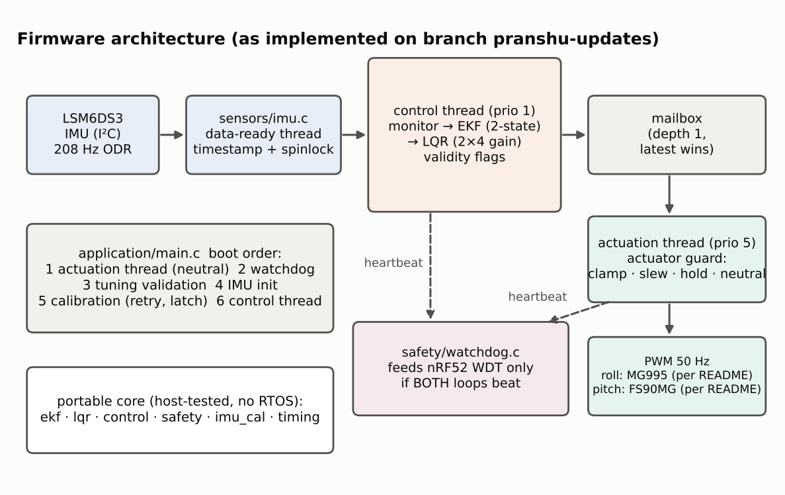

# TremoSense firmware architecture (as implemented)

Describes `firmware/` on branch `pranshu-updates`. Evidence class: source inspection plus host tests and a compile check against Zephyr v4.0.0 (no hardware run).

## Layers

| Layer | Files | Depends on Zephyr? | Host-tested |
|---|---|---|---|
| Portable core | `estimation/ekf.c`, `control/lqr.c`, `control/control.c`, `safety/safety.c`, `sensors/imu_cal.c`, `common/timing.c` | no | yes |
| Zephyr glue | `sensors/imu.c`, `actuation/pwm.c`, `safety/watchdog.c`, `application/*.c` | yes | no (compile-checked only) |

The core takes plain floats/structs and returns status codes, so it can be tested on a PC and reasoned about independently of the RTOS.

## Threads and data flow

1. **IMU data-ready handler** (`imu.c`): timestamps with `k_cycle_get_32()`, stores the latest sample under a spinlock with a sequence number, gives a semaphore. Dropped samples are counted.
2. **Control thread** (prio 1, `control_task.c`): waits for a sample, computes wrap-safe `dt`, runs `control_step` (monitor → EKF → LQR), posts a `servo_cmd_t` (angles + validity + fault flags) to a depth-1 latest-wins message queue.
3. **Actuation thread** (prio 5, `pwm.c`): waits ≤ 50 ms for a command; on timeout declares the command invalid. Runs the actuator guard (clamp → slew limit → HOLD ≤ 100 ms → SAFE_NEUTRAL), converts to PWM pulse, and beats its watchdog heartbeat.
4. **Watchdog supervisor** (`watchdog.c`): every 100 ms feeds the nRF52 WDT only if both control and actuator heartbeats advanced (after a 60 s boot window).

## Boot order (`main.c`)

actuation thread (outputs neutral) → watchdog → tuning validation (`control_init`) → IMU init → calibration (3 attempts) → control thread → `actuation_enable(true)` only if tuning and calibration are valid → arm runtime watchdog.

## Behavioural differences from the pre-update firmware

| Topic | Before | Now |
|---|---|---|
| Shipped tuning (Q=R=K=0) | ran, EKF produced NaN | refuses to actuate, holds neutral |
| `dt` | quantised to ms | exact from cycle counter |
| Bad IMU data | passed through | classified; guard holds then neutral |
| Control loop stall | undetected | actuator timeout + watchdog |
| Calibration | single pass, no validation | motion/orientation checks, retries, latch |
| EKF/LQR math on valid data | — | bit-identical (host regression: max diff 0.0°) |

See `AUDIT.md` for the full finding list and `../risk-management/SAFETY_ARCHITECTURE.md` for safe-state rationale.

## Known limitations

- Real-time behaviour (jitter, CPU load, stack margin) has **not** been measured on hardware.
- Q/R/K and plant parameters for the real device are not in the repository; the firmware cannot run closed-loop until they are supplied.
- Servo stall, over-temperature and brown-out cannot be detected with the current hardware.
