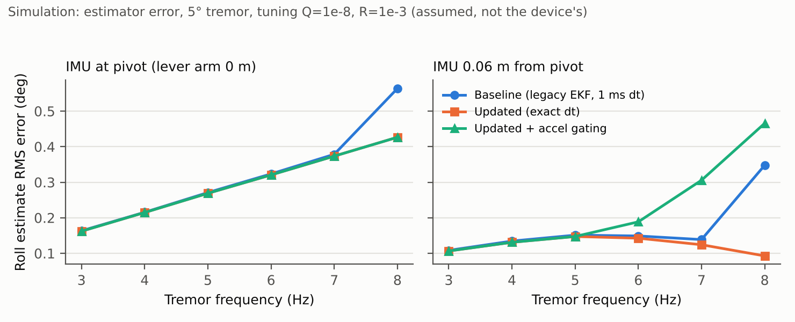
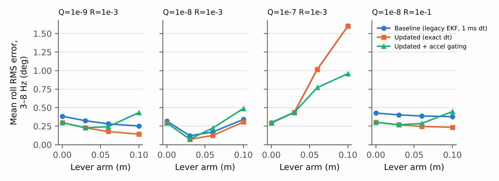

# EKF comparison study (simulation only)

> **Evidence class: SIMULATION with an assumed sensor model. Not hardware, not HIL, not user data.** The tunings below are placeholders; the device's real Q/R/K are not in the repository.

Reproduce: `gcc`-built batch harness `analysis/scripts/ekf_batch.c` driven by `analysis/scripts/ekf_comparison.py`; raw output `analysis/results/ekf_comparison.json`; plots by `analysis/scripts/make_figures.py`.

## Setup

- Sample rate 208 Hz; tremor amplitude 5.0° (roll), 3–8 Hz; 10 seeds per point.
- Assumed IMU noise: accel noise density 0.9 mg/√Hz, i.e. 0.090 m/s² rms per sample (≈ 9 mg), gyro noise density 0.007 dps/√Hz, i.e. 0.0012 rad/s rms per sample (≈ 0.07 dps); residual gyro bias (dps) [0.015, -0.01, 0.005].
- Lever arms (IMU offset from pivot): [0.0, 0.03, 0.06, 0.1] m — IMU mounting on the real device is unknown.
- Configs: **baseline** = verbatim legacy EKF with ms-quantised `dt`; **updated** = refactored EKF with exact `dt`; **gated** = updated + accel-norm gating (`EKF_GATE_*`, default off in firmware).
- Gate: band 3.0 m/s², R scale ×100.

## Mean roll-estimate RMS error over 3–8 Hz (deg; lower is better)

| Tuning | Lever (m) | Baseline | Updated | Gated |
|---|---|---|---|---|
| T1 Q=1e-9 R=1e-3 | 0.00 | 0.384 | 0.299 | 0.299 |
| T1 Q=1e-9 R=1e-3 | 0.03 | 0.324 | 0.228 | 0.228 |
| T1 Q=1e-9 R=1e-3 | 0.06 | 0.281 | 0.178 | 0.243 |
| T1 Q=1e-9 R=1e-3 | 0.10 | 0.252 | 0.142 | 0.433 |
| T2 Q=1e-8 R=1e-3 | 0.00 | 0.319 | 0.294 | 0.294 |
| T2 Q=1e-8 R=1e-3 | 0.03 | 0.121 | 0.073 | 0.076 |
| T2 Q=1e-8 R=1e-3 | 0.06 | 0.172 | 0.124 | 0.224 |
| T2 Q=1e-8 R=1e-3 | 0.10 | 0.341 | 0.306 | 0.489 |
| T3 Q=1e-7 R=1e-3 | 0.00 | 0.299 | 0.294 | 0.294 |
| T3 Q=1e-7 R=1e-3 | 0.03 | 0.437 | 0.433 | 0.435 |
| T3 Q=1e-7 R=1e-3 | 0.06 | 1.018 | 1.016 | 0.771 |
| T3 Q=1e-7 R=1e-3 | 0.10 | 1.602 | 1.601 | 0.960 |
| T4 Q=1e-8 R=1e-1 | 0.00 | 0.428 | 0.303 | 0.303 |
| T4 Q=1e-8 R=1e-1 | 0.03 | 0.403 | 0.268 | 0.268 |
| T4 Q=1e-8 R=1e-1 | 0.06 | 0.387 | 0.247 | 0.287 |
| T4 Q=1e-8 R=1e-1 | 0.10 | 0.379 | 0.234 | 0.448 |

## Reading the results (what is and is not supported)

- Updated (exact `dt`) had a mean 3–8 Hz roll RMS error ≤ baseline in 16 of 16 tuning/lever combinations; the gain ranges from negligible (T3, large lever) to ~0.1–0.15° (T1/T4). This is a simulated estimator-error result under assumed noise, not a device result.
- Accel gating is **not** a uniform win: it helps in some high-Q / large-lever cases and hurts in others. It stays **default off**.
- With high Q and a large lever arm all configs degrade; the result depends on the unknown IMU placement and tuning, so no device-level improvement is claimed.
- Nothing here validates the ~90 % tremor-rejection claim; see `CLAIM_AUDIT.md`.

## Limitations
- Assumed noise/lever model; no servo/plant dynamics; roll-only tremor excitation; estimator error ≠ closed-loop tremor rejection.
- Synthetic seeds are deterministic; variability across seeds is stored in the JSON (`rms_roll_sd`).

